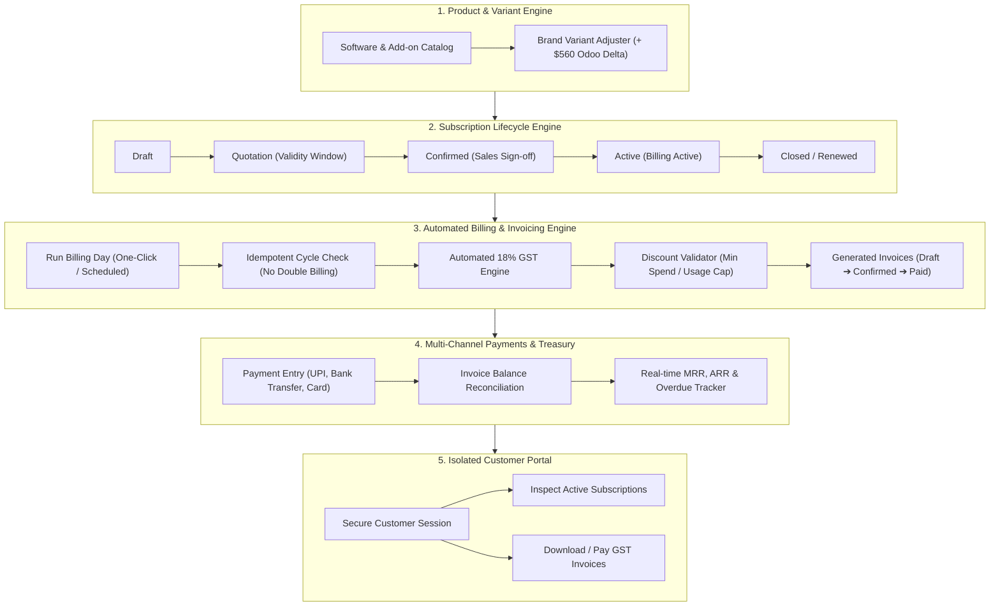

# ⚡ Brightloop — Enterprise Subscription Management & Automated Billing Engine

> **Odoo x FLUX Hackathon '26** | **Grand Submission**  
> Built by: **Vivek Onkarnath Bharati**, **Ranit Biswas**, **Pawan Vimlesh Mishra**, **Prithwi Roy**  
> 🌐 **Live Deployed Application:** [https://brightloop-subscriptions-7xqd.vercel.app](https://brightloop-subscriptions-7xqd.vercel.app)  
> 📂 **GitHub Repository:** [https://github.com/vivekonkarnathbharati/brightloop-subscriptions](https://github.com/vivekonkarnathbharati/brightloop-subscriptions)

---

## 📌 Executive Overview & The Problem

**Brightloop Software** sells enterprise business software, add-on modules, and multi-tier product variants on recurring subscription cycles. Traditionally, recurring businesses manage customer billing across brittle spreadsheets and manual reconciliation:
- **Renewals get missed** or remembered late by whoever happens to notice.
- **Invoices are typed manually**, resulting in calculation errors, tax inaccuracies, and double-billing.
- **Payments are manually matched** by scrolling line-by-line through bank statements.
- **Financial metrics (MRR, ARR, overdue accounts)** take days of manual spreadsheet crunching.

**Brightloop** is an enterprise-grade digital backbone built from the ground up to automate the entire lifecycle of a subscription business: from product variant setup and dynamic quotation building to automated billing runs, tax compliance, and real-time revenue intelligence.

---

## 🚀 Key Architectural Modules



---

## 🌟 Core System Capabilities

### 1. 🏷️ Product Catalog & Variant Pricing Engine
- Supports multiple product categories: **Core Software**, **Add-on Modules**, and **Support SLAs**.
- **Dynamic Variant Modifier**: Supports attribute-based price deltas. As explicitly mandated in the specification, selecting the **"Odoo Enterprise Edition"** variant dynamically injects a **+$560.00** price adjustment across quotation lines and invoice calculations.

### 2. 🔄 Subscription Lifecycle State Machine
- Enforces an audit-logged, deterministic state machine:
  $$\text{Draft} \longrightarrow \text{Quotation} \longrightarrow \text{Confirmed} \longrightarrow \text{Active} \longrightarrow \text{Closed}$$
- Configurable renewal, auto-close, and pause policies across **Daily**, **Weekly**, **Monthly**, and **Yearly** billing frequencies.
- Quotation templates pre-fill product lines and enforce validity expiry dates.

### 3. ⚡ Automated Billing Day & Anti-Duplicate Safeguard
- **One-Click Batch Invoicing**: Simultaneously bills all active subscriptions due on the billing cycle.
- **Anti-Duplicate Invoicing (Idempotency)**: Enforces cycle-level tracking keys (`subscriptionId` + billing period window). Subscriptions are **guaranteed never to be double-billed or skipped**.
- **Automated Tax Calculation**: Dynamically computes 18% GST (CGST + SGST or IGST) across all generated line items.

### 4. 🎟️ Discount Governance & Leakage Prevention
- **Admin-Only Rule Engine**: Eliminates unmonitored discount leakage.
- Configurable as **Percentage (%)** or **Fixed Amount ($ / ₹)**.
- Enforces strict criteria: **Minimum Purchase Amount**, **Minimum Quantity Thresholds**, **Active Date Windows**, and **Hard Usage Limits** (automatically deactivates once the redemption cap is exhausted).

### 5. 💳 Multi-Channel Payment Recording
- Real-time ledger supporting **UPI**, **Bank Transfer (IMPS/NEFT)**, **Credit Card**, and **Cash**.
- Tracks partial payments and auto-transitions invoice statuses from `Confirmed` $\rightarrow$ `Partially Paid` $\rightarrow$ `Paid` once fully settled.
- Instant reference note logging for audit trails.

### 6. 📊 Executive Finance Dashboard (< 2s Response SLA)
- Real-time, instant-load executive metrics:
  - **Monthly Recurring Revenue (MRR)** & **Annual Recurring Revenue (ARR)**
  - **Total Revenue Collected** vs. **Outstanding Receivables**
  - **Overdue Invoices Tracker** with fast customer chasing workflows
  - Interactive Recharts visualization for revenue trajectory

### 7. 👤 Isolated Customer Self-Service Portal
- Dedicated portal experience for client accounts (e.g. Nexus Retail).
- Zero cross-tenant data leakage: customers securely view only their own subscriptions, review payment terms, inspect upcoming renewals, and view/print GST-compliant tax invoices.

---

## 🔐 Evaluator & Demo Credentials

Use these pre-configured accounts to test all user roles and permissions:

| Persona | Email / Username | Password | Access Scope |
| :--- | :--- | :--- | :--- |
| **👑 System Administrator** | `admin@brightloop.io` *(or `admin@brightloop.com`)* | `AdminPassword@2026` | Full system governance, staff onboarding, discount rules, tax policies, billing runs |
| **💼 Sales Rep (Staff)** | `sarah.sales@brightloop.io` | `SalesPassword@2026` | Quote generation, customer management, subscription pipeline |
| **👤 Customer Portal #1** | `rajesh@nexusretail.in` | `NexusCustomer@2026` | Self-service portal (Nexus Retail Enterprises) |
| **👤 Customer Portal #2** | `ananya@cloudpulsetech.com` | `CloudPulse@2026` | Self-service portal (CloudPulse Technologies) |

> **Password Policy**: All accounts enforce enterprise security ($\ge 8$ characters, at least 1 uppercase letter, 1 lowercase letter, and 1 special character).

---

## 🛠️ Technology Stack

| Layer | Technology | Details |
| :--- | :--- | :--- |
| **Framework** | **Next.js 16 (App Router)** | High-performance server components and API route handlers |
| **Runtime & UI** | **React 19** | Modern UI primitives with reactive state updates |
| **Styling** | **Tailwind CSS v4** | Modern, token-based design system with responsive layouts |
| **Icons & Visuals** | **Lucide React + Recharts** | Enterprise dashboard KPI visualization & financial charts |
| **Data Layer** | **Prisma ORM (v6)** | Type-safe schema, migrations, and relationship integrity |
| **Database** | **SQLite (Self-Contained)** | High-speed, zero-config local database with sub-millisecond query latency |
| **Deployment** | **Vercel Edge Platform** | Production deployed with continuous CI/CD integration |

---

## 💻 Local Setup & Development Guide

Follow these steps to run the complete Brightloop platform locally on your machine:

### 1. Clone the Repository
```bash
git clone https://github.com/vivekonkarnathbharati/brightloop-subscriptions.git
cd brightloop-subscriptions
```

### 2. Install Dependencies
```bash
npm install
```

### 3. Push Database Schema
```bash
npx prisma db push
```

### 4. Seed Enterprise Demo Data
Populate the database with pre-configured products, Odoo variants, discount rules, active subscriptions, and historical invoices:
```bash
npx tsx prisma/seed.ts
```

### 5. Launch the Development Server
```bash
npm run dev
```

Open [http://localhost:3000](http://localhost:3000) in your browser.

---

## 📂 Project Structure

```
brightloop-subscriptions/
├── prisma/
│   ├── schema.prisma        # 10 Interconnected relational data models
│   ├── dev.db               # SQLite database
│   └── seed.ts              # Rich enterprise mock data generator
├── src/
│   ├── app/
│   │   ├── api/             # REST API routes (billing, quotes, payments, dashboard)
│   │   ├── subscriptions/   # Subscription lifecycle & quotation pipeline
│   │   ├── invoices/        # Billing engine, invoice viewer, and payment modal
│   │   ├── products/        # Product catalog & variant adjustment manager
│   │   ├── discounts/       # Admin discount rules & cap governance
│   │   ├── portal/          # Dedicated customer self-service portal
│   │   ├── layout.tsx       # Root layout with navigation & quick-role switcher
│   │   └── page.tsx         # Executive Finance Dashboard & MRR analytics
│   ├── components/          # Reusable UI components & modals
│   └── lib/
│       └── prisma.ts        # Singleton Prisma client instance
├── package.json
└── README.md
```

---

## 🏆 Hackathon Team Credits

* **Vivek Onkarnath Bharati**
* **Ranit Biswas**
* **Pawan Vimlesh Mishra**
* **Prithwi Roy**

---

*Brightloop — Bridging the gap between payments and enterprise operations.*
