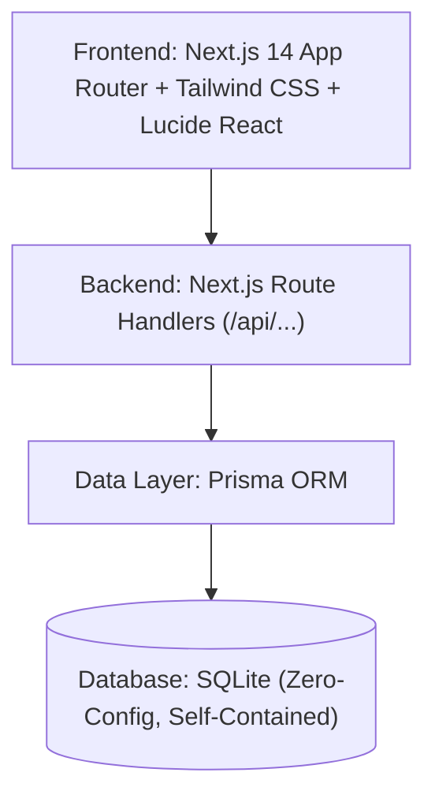

# 🌟 Brightloop Subscription Management System

> **Odoo Hackathon 2026 Submission** | **Virtual Round**  
> Built by Team Vivek Onkarnath Bharati, Ranit Biswas, Pawan Vimlesh Mishra, Prithwi Roy.

---

## 📌 Executive Summary
**Brightloop Software** sells enterprise business software, add-ons, and product variants on recurring subscription cycles. Previously managed through fragile manual spreadsheets and prone to missed renewals, delayed invoices, and revenue leakage, this platform provides Brightloop with a centralized, automated recurring billing engine.

---

## 🚀 Key Capabilities

### 1. 🛡️ Role-Based Access Control (RBAC)
- **Admin**: Complete system oversight, staff member onboarding, tax configuration, and global discount rules.
- **Internal Staff / Sales Rep**: Daily customer management, quote generation, and subscription tracking.
- **Customer Portal**: Self-service portal where customers exclusively view their own active subscriptions, download invoices, and inspect billing history.
- **Enterprise Security**: Enforced password complexity (uppercase, lowercase, special character, 8+ length) and email uniqueness.

### 2. 📦 Product & Variant Catalog
- Multi-tier product setup (Software, Add-ons, Services) with baseline sales and cost prices.
- **Variant Engine**: Dynamic price adjustments (e.g., Selecting "Odoo" brand variant automatically adds +$560 to line item calculations).

### 3. 🔄 Subscription Lifecycle State Machine
- Linear audit-logged status transitions:
  $$\text{Draft} \longrightarrow \text{Quotation} \longrightarrow \text{Confirmed} \longrightarrow \text{Active} \longrightarrow \text{Closed}$$
- Configurable renewal, auto-close, and pause behaviors across daily, weekly, monthly, and yearly cycles.

### 4. ⚡ Automated Billing & Invoicing Engine
- One-click and batch invoice generation directly from active subscriptions.
- Automated tax rules (18% GST baseline) and discount deduction.
- Idempotent generation logic preventing double-billing or skipped billing periods.
- Invoice states: `Draft` $\rightarrow$ `Confirmed` $\rightarrow$ `Paid`.

### 5. 🏷️ Discount & Promotion Engine
- Admin-governed rules: Fixed amount or Percentage discounts.
- Enforces minimum purchase amounts, minimum seat quantities, active date windows, and hard usage caps (auto-deactivates once limit is exhausted).

### 6. 📊 Executive Finance Dashboard
- Real-time KPIs: **Monthly Recurring Revenue (MRR)**, **Annual Recurring Revenue (ARR)**, **Active Subscriptions**, and **Overdue Invoices**.
- Sub-2-second query response time with CSV/PDF reporting capabilities.

---

## 🛠️ Architecture & Tech Stack



- **Frontend & Backend**: Next.js 14+ (App Router, TypeScript)
- **Styling**: Tailwind CSS + shadcn/ui patterns
- **Database**: SQLite with Prisma ORM
- **Visualizations**: Recharts

---

## 💻 Local Setup & Run Guide

```bash
# 1. Clone the repository
git clone https://github.com/vivekonkarnathbharati/brightloop-subscriptions.git
cd brightloop-subscriptions

# 2. Install dependencies
npm install

# 3. Synchronize database schema
npx prisma db push

# 4. Run the development server
npm run dev
```

Open [http://localhost:3000](http://localhost:3000) in your browser.
